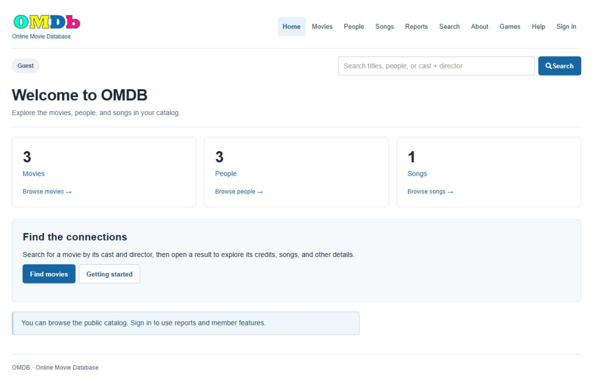

# OMDB2 — Online Movie Database

OMDB2 is a PHP/MySQL catalog for movies, people, songs, and their credits. Visitors can browse and search; signed-in members also use reports and games. Administrators maintain the catalog, relationships, posters, imports, and member accounts.

This repository contains the application, an empty schema, fictional sample data, installation instructions, screenshots, and reproducible tests. Start here for a new installation; an old developer database or password is not required.



## Requirements

| Component | Requirement |
|---|---|
| Web server | Apache with PHP and `.htaccess` enabled (`AllowOverride All`) |
| PHP | 8.0+; `mysqli` with mysqlnd, `mbstring`, `fileinfo`, `session`, and `json` |
| Database | MariaDB 10.4+ or MySQL 8.0; InnoDB and UTF-8 support |
| Browser | JavaScript and cookies enabled |
| Source download | Git, or GitHub's **Code → Download ZIP** |
| Tests / ZIP builder only | Python 3.12+, Git, PHP CLI, MySQL command-line client |

XAMPP supplies Apache, PHP and MariaDB on Windows. Fresh installation was verified with PHP 8.0.30 / MariaDB 10.4.32; GitHub Actions also exercises MySQL 8.0. Application assets are included locally. Composer, Node/npm, a movie API key, and a cloud account are not needed. See [known limitations](docs/known-limitations.md) for deployment scope and legacy dependencies.

## Install with XAMPP on Windows

These examples use a **new** folder `C:\xampp\htdocs\omdb-final`, a **new** database `omdb_final`, Apache port 80 and database port 3306. Use your chosen names/ports consistently. Keep an existing installation in its own folder/database.

### 1. Start XAMPP and check PHP

Start **Apache** and **MySQL** in XAMPP Control Panel. The MySQL button starts MariaDB in XAMPP. Confirm `http://localhost/` and `http://localhost/phpmyadmin/` open.

```powershell
& C:\xampp\php\php.exe -v
& C:\xampp\php\php.exe -m
```

Confirm the required extensions. Enable missing extensions in `C:\xampp\php\php.ini`, then restart Apache. Preserve the repository's `.htaccess` files; they protect configuration, includes, tooling, and database files.

### 2. Download a fresh copy from GitHub

```powershell
git clone https://github.com/sjasthi/omdb2.git C:\xampp\htdocs\omdb-final
Set-Location C:\xampp\htdocs\omdb-final
git rev-parse HEAD
```

Record the commit for your installation notes. For a ZIP download, extract so `README.md`, `index.php`, `sql`, and `vendor` are directly inside `omdb-final`, rather than an extra `omdb2-main` folder. The app runs from a ZIP; Git is needed for the package builder and tracked-source checks.

### 3. Create and import the database

In phpMyAdmin, choose **New**, create `omdb_final` with collation **utf8mb4_unicode_ci**, select that database, then use **Import** to load `C:\xampp\htdocs\omdb-final\sql\schema.sql`.

Expected: **23 tables**, **17 cascading foreign keys**, and **zero accounts**. This schema contains no production records or passwords. Historical dumps are not installation inputs.

Alternatively, use PowerShell. `-p` prompts privately for your local database administrator password; on stock local XAMPP with no root password, press Enter.

```powershell
& C:\xampp\mysql\bin\mysql.exe -h 127.0.0.1 -u root -p -e "CREATE DATABASE omdb_final CHARACTER SET utf8mb4 COLLATE utf8mb4_unicode_ci"
& C:\xampp\mysql\bin\mysql.exe -h 127.0.0.1 -u root -p omdb_final -e "SOURCE C:/xampp/htdocs/omdb-final/sql/schema.sql"
```

Use **one** import method on an empty database. An existing-table error usually means it was already imported. [Schema diagram and data dictionary](docs/schema.md) explain the tables.

### 4. Configure the database connection

For a restricted application account, use phpMyAdmin **User accounts** to create a database user with a private password and **SELECT, INSERT, UPDATE, DELETE on `omdb_final` only**. Import/migration uses a separate account with DDL privileges. A stock local XAMPP root account can be used for a classroom-only installation; the fresh verification tested a restricted application account.

```powershell
Copy-Item db_credentials.example.php db_credentials.php
notepad db_credentials.php
```

Fill in the existing constants:

| Setting | Local value |
|---|---|
| `DB_SERVER` | `127.0.0.1`; use `127.0.0.1:3307` for database port 3307 |
| `DB_USER` | The database account you selected |
| `DB_PASS` | Its private password; blank only if that local account has no password |
| `DB_NAME` | `omdb_final` |

Save locally. This file is ignored by Git and must never be uploaded. This is the **database** login, not an application email/password. Verify with `git check-ignore db_credentials.php`.

Alternatively provide all four server-environment variables: `OMDB_DB_SERVER`, `OMDB_DB_USER`, `OMDB_DB_PASS`, `OMDB_DB_NAME`. Environment variables in a PowerShell window do not configure an already-running Apache process; the local file is simplest for XAMPP.

### 5. Create your first administrator

Run the CLI bootstrap once while `users` is empty. Choose your own email and a private password of **12–72 UTF-8 bytes**. This example prompts without putting the password in command history:

```powershell
$adminEmail = Read-Host 'Administrator email'
$adminSecret = Read-Host 'Administrator password (12-72 bytes)' -AsSecureString
$env:OMDB_ADMIN_PASSWORD = [System.Net.NetworkCredential]::new('', $adminSecret).Password
try {
    & C:\xampp\php\php.exe tools/create-admin.php $adminEmail
} finally {
    Remove-Item Env:OMDB_ADMIN_PASSWORD -ErrorAction SilentlyContinue
    $adminSecret.Dispose()
}
```

Expected: **Initial administrator created.** Bootstrap refuses another administrator once any account exists. There are **no default application logins**; a previous developer's accounts are not created by the schema.

Optional read-only schema check:

```powershell
& C:\xampp\php\php.exe tools/migrate.php --check
```

Expected: exit 0 and no blockers. Fresh setup already has migration `007_database_cleanup`; do not import the schema again.

### 6. Open the application and sign in

Open **http://localhost/omdb-final/**, choose **Sign in**, and enter the application email/password you created. You should see **Administrator** and **Admin**.

Use **Admin → Create user account** to create a member. Account creation always creates `USER`; submitted role overrides cannot create administrators. Sign out and sign in as the member to confirm that Admin and catalog write controls are absent.

| Role | Functions |
|---|---|
| Guest | Browse/view/search the public catalog |
| `USER` / Member | Public features, signed-in reports and member games; catalog is read-only |
| `ADMIN` | Create/edit/delete records, manage relationships, CSV imports, posters, puzzle data, and USER accounts |
| `SUPER-ADMIN` | Same management policy as ADMIN; no separate promotion screen |

Administrative endpoints enforce login, role, method and CSRF protection when opened directly, too.

### 7. Import optional samples and try the main workflow

An empty catalog is expected. To reproduce the screenshots, import [movies.csv](examples/movies.csv), [people.csv](examples/people.csv), and [songs.csv](examples/songs.csv) through **Admin → Import data**, selecting the matching record type. Expected: 3 movies, 3 people, 1 song. These records are fictional.

Follow [the sample guide](examples/README.md) to attach credits through a movie's **People** and **Songs** actions. Search for **Avery Stone** under Cast member and **Morgan River** under Director: Harbor Lights should be the single match. The app searches stored records; it does not download movie information.

CSV is UTF-8, **no header**, at most 10,000 records and a 5 MB application cap. Quoted commas/newlines work. Invalid rows roll back the upload. Movie native-title/year duplicates are skipped; people/songs create new rows on repeat imports. PHP may impose a lower upload limit. To allow 5 MB, configure `upload_max_filesize=5M` and `post_max_size=8M` in PHP, then restart Apache.

## Screenshots and help

[Screenshot walkthrough](docs/screenshots.md): home, sign-in, member/admin controls, combined search, imports, forms, Help, and a phone layout. **Help** inside the app explains current user workflows.

## Troubleshooting

| Symptom | Check |
|---|---|
| Cannot connect | Apache is running; use its port, e.g. `http://localhost:8080/omdb-final/` |
| Whole app is 404 | `index.php` is directly under `htdocs/omdb-final`; URL matches folder |
| Generic database error | Private Apache/PHP log, all connection settings, database port, schema and grants |
| Unknown table / empty catalog | Import schema into `DB_NAME`; an empty catalog is normal before adding data |
| Bootstrap fails | Empty `users`, valid email/password, CLI uses the same local configuration |
| USER cannot open Admin | Expected role enforcement; use the administrator account |
| Search has no matches | Add people and credits first; shorten a name or clear filters |
| CSV rejected | File type, encoding, column order, field lengths and PHP upload limits |
| Styling/tables missing | Preserve local assets, enable JavaScript, inspect browser console |
| XAMPP permission-table corruption | Database-server installation issue; use a clean instance or verified server backup. App schema import cannot repair MariaDB system tables |

For database port 3307, add `-P 3307` to MySQL CLI commands and use `127.0.0.1:3307` for `DB_SERVER`. The independent clean verification instance on this PC used 3307. Keep technical log details out of public screenshots/reports.

## Database, changes and limitations

- [Schema diagram and table/column dictionary](docs/schema.md)
- [Backend ownership, transactions and migration](docs/database.md)
- [Changes from the original sjasthi/omdb2](docs/changes-from-original.md)
- [Known limitations and remaining work](docs/known-limitations.md)
- [Deployment, backups and upgrades](docs/deployment.md)
- [Security model and historical credential follow-up](SECURITY.md)

## Tests and final results

With the database server running, from a Git clone:

```powershell
python tests/run_week9.py --php C:/xampp/php/php.exe --mysql C:/xampp/mysql/bin/mysql.exe --output C:/omdb-test-results/final
```

The **test** database account needs CREATE/DROP DATABASE privileges. Set `OMDB_TEST_DB_SERVER`, `OMDB_TEST_DB_USER`, and `OMDB_TEST_DB_PASSWORD` if needed. This runner creates random accounts and exclusive disposable databases, copies source without local credentials, runs five suites, records expected/actual/pass/fail, and cleans up. Never point standalone HTTP scripts at a live database.

The final run from a fresh GitHub clone passed **1,135 functional checks**: 62 backend, 273 search, 307 security HTTP, 132 UI HTTP, 361 matrix cases. Another **38 fresh-install acceptance checks** passed. See [final static-analysis and functional-test report](docs/final-test-report.md) and [fresh-install record](docs/fresh-installation.md). GitHub Actions repeats syntax, secrets and all five suites on MariaDB 10.4 and MySQL 8.0.

Enable local hooks with `git config core.hooksPath .githooks` and PHP on PATH. Before uploading, run `php tools/check-secrets.php --all`. These checks do not erase old Git history.

## Build a deployment ZIP

From a clean Git clone at the commit you want to deliver:

```powershell
python tools/package-release.py --output C:/omdb-delivery/omdb2-final.zip
```

The ZIP contains tracked source, schema/migration, examples, screenshots, docs and local assets under `omdb-final/`. Its adjacent JSON manifest records the commit, source-tree ID and ZIP SHA-256. Local configuration, Git history, test logs and live database rows are excluded. Extract into XAMPP and follow the same steps above. See [deployment details](docs/deployment.md).
