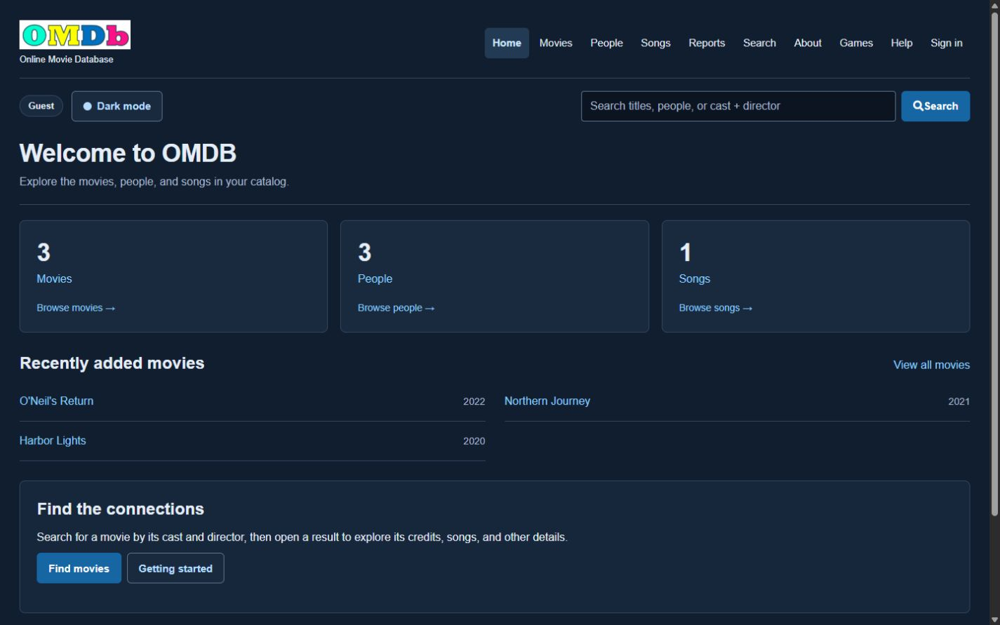
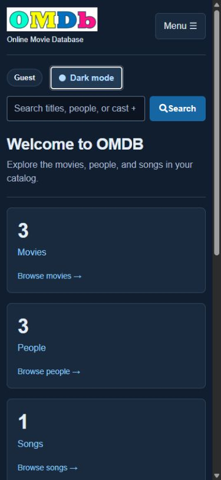

# Dark mode

Choose **Dark mode** beside the account badge to turn the theme on or off. The control remains visible outside the collapsed navigation on phones. It is a native keyboard-accessible button with a pressed state. Safe error pages have the same control.

OMDB uses the device's color preference on a first visit. Choosing a theme saves `light` or `dark` under `omdb.theme` in this browser's local storage. That choice takes precedence over the device preference and persists through navigation, reloads and sign-in/sign-out. Separate browsers have separate preferences. With JavaScript disabled the normal light pages remain usable and the toggle stays hidden.

The early [theme script](../scripts/theme.js) applies the preference before styles load. The shared [theme stylesheet](../styles/theme.css) covers navigation, tables, forms, notices, relationship controls, movie details and error pages. It preserves poster and logo image colors. No database schema or account setting is required.

## Verification on November 17, 2026

- All **16 browser checks passed**, including light/dark switching, keyboard activation, persistence across navigation/reload/authentication, dark form surfaces, legacy movie/relationship views and the error-page toggle.
- The home page and 44-pixel theme control fit at **390, 768, 1366 and 1440 pixels** without horizontal page overflow. Phone switching worked in both directions.
- No browser console errors were observed during these checks. Screenshots used the fictional demonstration catalog and excluded credential entry.
- The full isolated regression suite passed again: **62 backend + 273 search + 307 HTTP security + 132 HTTP UI + 361 matrix = 1,135 PASS / 0 FAIL**. The 361 matrix cases are part of that total. Disposable test databases were removed after the run.
- The three changed PHP files and new JavaScript passed syntax checks. The staged secret scan and Git whitespace check passed before the local commit.

[Browser observations and regression summary](dark-mode-results.json) record this run. The previous installation and presentation reports retain their original scope. Desktop and phone screenshots are included here, and the detailed local runtime logs stay outside the repository/web folder.

