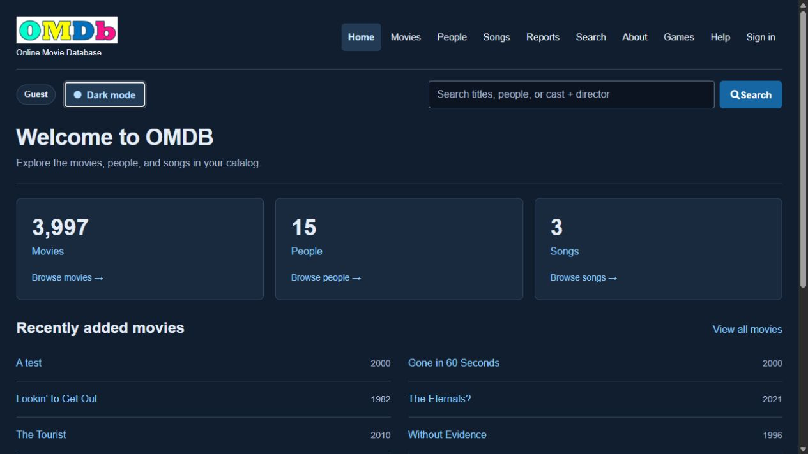

# Original catalog restoration and update

Verified **November 17, 2026**. The original local `/omdb/` installation now serves the current application code and its full existing catalog. The separate `/omdb-final/` installation remains a fictional three-movie rehearsal fixture.

## Preserved records

| Data | Before restoration | After restoration |
|---|---:|---:|
| Movies | 3,997 | 3,997 |
| People | 15 | 15 |
| Songs | 3 | 3 |
| Movie credits | 138 | 138 |
| Movie/song relationships | 3 | 3 |
| Song credits | 5 | 5 |
| Accounts | 4 | 4 |
| Tables | 23 | 23 |
| Foreign keys | 17 | 17 |

The comparison includes every table, including optional movie details, media references, derived data, anagrams, migration history and archived legacy rows. Record counts, SHA-256 hashes of complete row multisets, and table-definition hashes match the recovered source. Both original administrator/member logins were verified without changing their passwords.

## Recovery and deployment

The original site failed because its port-3306 database server was stopped, and its `mysql.db` permission table was corrupted. Before recovery, the complete stopped data directory and web folder were copied to a private backup outside the web root and checked file by file with SHA-256 hashes.

Recovery used a second disposable copy on loopback port 3308. Only that copy's Aria permission table was repaired, following [MariaDB's aria_chk guidance](https://mariadb.com/docs/server/clients-and-utilities/aria-clients-and-utilities/aria_chk). Its damaged permission rows were not reused as production grants. The application database was exported logically and imported into a new database on the existing healthy loopback port-3307 instance. A new restricted connection account permits SELECT/INSERT/UPDATE/DELETE and denies CREATE TABLE. The original raw data directory remains untouched as a recovery source.

The existing `/omdb/` folder received the current code after checking its older deployed files against repository history. Local media and other unrelated files were preserved. The private database configuration switched only after the import and all-table comparison passed. The setup schema and fictional CSV examples were not imported over the catalog.

The local delivery includes a **Start Full OMDB.private.cmd** launcher that supplies this server's configuration and opens `/omdb/`. It does not require the fictional demo records. Use that launcher or the documented non-default-port startup command after a reboot. The ordinary XAMPP MySQL button still refers to the older port-3306 instance, rather than this restored deployment.

## Reproduced issues fixed during verification

- Login sessions previously shared a default cookie across installations. Each installation now has its own session-cookie name and URL path, so the demo cannot confer its login on the original site. Four automated cases cover session separation and replaying another installation's cookie.
- A browser retained older CSS/JavaScript at the original URL. Maintained assets now carry a content-hash version, so a code upgrade also refreshes the cached assets. The recent-movie layout and Clear filters control were verified on the full catalog.
- Six media rows refer to poster files that were already absent from the original upload folder at backup time. Their database rows remain preserved. Movie details now show a local placeholder for a missing file, and can choose another available poster after a stale reference. Two HTTP regression cases cover those behaviors. Existing image/media assets that were present remain preserved; missing original artwork was not invented or downloaded.

## Evidence

The complete isolated suite passed **1,141 / 1,141** checks: backend 62, combined search 273, HTTP security 307, HTTP UI 134, edge-case matrix 361 and installation sessions 4. The 361 matrix cases are included in that total. Tests used disposable databases and removed them afterward.

The live restored site additionally passed 18 browser observations covering catalog totals, zero/one/many table filtering, the original login roles, denied member admin access, admin form access, the people/song catalogs, combined-search controls, the missing-poster placeholder, theme switching and phone layout. A signed-in original administrator did not sign into the separate demo. Initial failures found during verification were fixed and retested.

[Machine-readable preservation and test results](full-catalog-restoration-results.json) contain per-table counts/hashes and the final observations. Account-row hashes remain in the private comparison rather than the public report. Private raw backups, the logical SQL export, account passwords and machine-specific connection files stay outside Git and the web root.

