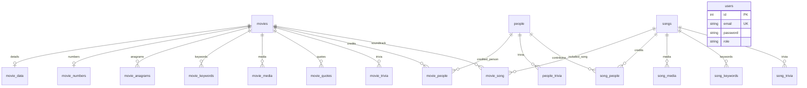

# Current database schema

Authoritative setup: [sql/schema.sql](../sql/schema.sql). This dictionary was generated from a fresh import on November 9, 2026, then checked against that schema: **23 InnoDB tables**, **17 foreign keys**, unique account email, and no seeded accounts. Use [database.md](database.md) for transactions/migration details and [README.md](../README.md) for setup.

## Core relationship diagram

All diagram links are actual `ON DELETE CASCADE` foreign keys. Deleting a movie removes its details and association rows while keeping people/songs. Deleting a person removes trivia/credits while keeping movies/songs. Deleting a song removes its child and association rows while keeping movies/people. `users` has no catalog foreign keys. The three retained legacy tables and two migration-support tables are separate from the catalog graph.

Generated IDs use AUTO_INCREMENT. Movie/person/song relationship tables use composite primary keys so the same exact association cannot be duplicated. `movie_data` and `movie_numbers` use the movie ID as their own primary key. `users.email` remains unique with the schema's case-insensitive collation.

## Table and column dictionary

`PRI` means primary-key column; `UNI` means a unique indexed column; `MUL` means an indexed column that permits repeated values. Blank defaults and required columns without a default are shown explicitly. Table/column names are the names used by the code, including retained legacy spelling.

### `movies`

Movie identity/title/year.

| Column | Type | Nullable | Key | Default / generated |
|---|---|---|---|---|
| `movie_id` | `int(11)` | NO | PRI | auto_increment |
| `native_name` | `varchar(180)` | NO | — | none |
| `english_name` | `varchar(180)` | NO | — | none |
| `year_made` | `year(4)` | NO | — | none |

### `movie_anagrams`

Owned catalog details or association data; foreign keys follow the diagram above.

| Column | Type | Nullable | Key | Default / generated |
|---|---|---|---|---|
| `movie_id` | `int(6)` | NO | MUL | none |
| `anagram_id` | `int(11)` | NO | PRI | auto_increment |
| `anagram` | `varchar(180)` | NO | — | none |

### `movie_data`

Owned catalog details or association data; foreign keys follow the diagram above.

| Column | Type | Nullable | Key | Default / generated |
|---|---|---|---|---|
| `tag_line` | `varchar(100)` | NO | — | none |
| `movie_id` | `int(6)` | NO | PRI | none |
| `language` | `varchar(10)` | NO | — | none |
| `country` | `varchar(20)` | NO | — | none |
| `genre` | `varchar(15)` | NO | — | none |
| `plot` | `varchar(500)` | NO | — | none |

### `movie_keywords`

Owned catalog details or association data; foreign keys follow the diagram above.

| Column | Type | Nullable | Key | Default / generated |
|---|---|---|---|---|
| `movie_id` | `int(6)` | NO | PRI | none |
| `keyword` | `varchar(15)` | NO | PRI | none |

### `movie_media`

Owned catalog details or association data; foreign keys follow the diagram above.

| Column | Type | Nullable | Key | Default / generated |
|---|---|---|---|---|
| `movie_media_id` | `int(11)` | NO | PRI | auto_increment |
| `m_link` | `varchar(100)` | NO | — | none |
| `m_link_type` | `varchar(10)` | NO | — | none |
| `movie_id` | `int(6)` | NO | MUL | none |

### `movie_numbers`

Owned catalog details or association data; foreign keys follow the diagram above.

| Column | Type | Nullable | Key | Default / generated |
|---|---|---|---|---|
| `movie_id` | `int(6)` | NO | PRI | none |
| `running_time` | `int(3)` | YES | — | NULL |
| `length` | `int(2)` | YES | — | NULL |
| `strength` | `int(2)` | YES | — | NULL |
| `weight` | `int(2)` | YES | — | NULL |
| `budget` | `int(8)` | YES | — | NULL |
| `box_office` | `int(8)` | YES | — | NULL |
| `base_chars` | `varchar(540)` | NO | — | none |

### `movie_people`

Owned catalog details or association data; foreign keys follow the diagram above.

| Column | Type | Nullable | Key | Default / generated |
|---|---|---|---|---|
| `movie_id` | `int(6)` | NO | PRI | none |
| `people_id` | `int(6)` | NO | PRI | none |
| `role` | `varchar(20)` | NO | PRI | none |
| `screen_name` | `varchar(30)` | NO | PRI | none |

### `movie_quotes`

Owned catalog details or association data; foreign keys follow the diagram above.

| Column | Type | Nullable | Key | Default / generated |
|---|---|---|---|---|
| `movie_id` | `int(6)` | NO | MUL | none |
| `movie_quote_id` | `int(11)` | NO | PRI | auto_increment |
| `movie_quote_name` | `varchar(300)` | NO | — | none |

### `movie_song`

Owned catalog details or association data; foreign keys follow the diagram above.

| Column | Type | Nullable | Key | Default / generated |
|---|---|---|---|---|
| `movie_id` | `int(6)` | NO | PRI | none |
| `song_id` | `int(6)` | NO | PRI | none |

### `movie_trivia`

Owned catalog details or association data; foreign keys follow the diagram above.

| Column | Type | Nullable | Key | Default / generated |
|---|---|---|---|---|
| `movie_id` | `int(6)` | NO | MUL | none |
| `movie_trivia_id` | `int(11)` | NO | PRI | auto_increment |
| `movie_trivia_name` | `varchar(300)` | NO | — | none |

### `mpr_test_data`

Retained legacy table; no current PHP callers.

| Column | Type | Nullable | Key | Default / generated |
|---|---|---|---|---|
| `id` | `int(11)` | NO | PRI | auto_increment |
| `native_name` | `varchar(180)` | NO | — | none |
| `year_made` | `year(4)` | NO | — | none |
| `stage_name` | `varchar(30)` | NO | — | none |
| `role` | `varchar(20)` | NO | — | none |
| `screen_name` | `varchar(30)` | NO | — | none |
| `execution_status` | `varchar(100)` | NO | — | none |

### `omdb_migration_archive`

Private original rows preserved during approved archival repairs. Never publish row_data.

| Column | Type | Nullable | Key | Default / generated |
|---|---|---|---|---|
| `id` | `bigint(20) unsigned` | NO | PRI | auto_increment |
| `source_table` | `varchar(64)` | NO | — | none |
| `reason` | `varchar(100)` | NO | — | none |
| `row_data` | `longtext` | NO | — | none |
| `archived_at` | `timestamp` | NO | — | current_timestamp() |

### `omdb_schema_migrations`

Applied schema versions; fresh setup records 007_database_cleanup.

| Column | Type | Nullable | Key | Default / generated |
|---|---|---|---|---|
| `version` | `varchar(64)` | NO | PRI | none |
| `applied_at` | `timestamp` | NO | — | current_timestamp() |

### `people`

Person identity, names and optional local image reference.

| Column | Type | Nullable | Key | Default / generated |
|---|---|---|---|---|
| `people_id` | `int(11)` | NO | PRI | auto_increment |
| `stage_name` | `varchar(30)` | NO | — | none |
| `first_name` | `varchar(20)` | NO | — | none |
| `middle_name` | `varchar(20)` | NO | — | none |
| `last_name` | `varchar(20)` | NO | — | none |
| `gender` | `varchar(6)` | NO | — | none |
| `image_name` | `varchar(30)` | NO | — | none |

### `people_trivia`

Owned catalog details or association data; foreign keys follow the diagram above.

| Column | Type | Nullable | Key | Default / generated |
|---|---|---|---|---|
| `people_id` | `int(6)` | NO | MUL | none |
| `people_trivia_id` | `int(11)` | NO | PRI | auto_increment |
| `people_trivia_name` | `varchar(300)` | NO | — | none |

### `person_matches`

Retained legacy table; no current PHP callers.

| Column | Type | Nullable | Key | Default / generated |
|---|---|---|---|---|
| `match_id` | `int(11)` | NO | PRI | auto_increment |
| `matches` | `varchar(30)` | YES | — | NULL |
| `type` | `varchar(6)` | YES | — | NULL |

### `songs`

Song identity/title/lyrics/theme.

| Column | Type | Nullable | Key | Default / generated |
|---|---|---|---|---|
| `song_id` | `int(11)` | NO | PRI | auto_increment |
| `title` | `varchar(20)` | NO | — | none |
| `lyrics` | `varchar(500)` | YES | — | NULL |
| `theme` | `varchar(20)` | NO | — | none |

### `song_keywords`

Owned catalog details or association data; foreign keys follow the diagram above.

| Column | Type | Nullable | Key | Default / generated |
|---|---|---|---|---|
| `song_id` | `int(5)` | NO | PRI | none |
| `keyword` | `varchar(15)` | NO | PRI | none |

### `song_matches`

Retained legacy table; no current PHP callers.

| Column | Type | Nullable | Key | Default / generated |
|---|---|---|---|---|
| `match_id` | `int(11)` | NO | PRI | auto_increment |
| `matches` | `varchar(20)` | YES | — | NULL |
| `type` | `varchar(4)` | YES | — | NULL |

### `song_media`

Owned catalog details or association data; foreign keys follow the diagram above.

| Column | Type | Nullable | Key | Default / generated |
|---|---|---|---|---|
| `song_media_id` | `int(11)` | NO | PRI | auto_increment |
| `s_link` | `varchar(100)` | NO | — | none |
| `s_link_type` | `varchar(10)` | NO | — | none |
| `song_id` | `int(6)` | NO | MUL | none |

### `song_people`

Owned catalog details or association data; foreign keys follow the diagram above.

| Column | Type | Nullable | Key | Default / generated |
|---|---|---|---|---|
| `song_id` | `int(6)` | NO | PRI | none |
| `people_id` | `int(6)` | NO | PRI | none |
| `role` | `varchar(15)` | NO | PRI | none |

### `song_trivia`

Owned catalog details or association data; foreign keys follow the diagram above.

| Column | Type | Nullable | Key | Default / generated |
|---|---|---|---|---|
| `song_id` | `int(6)` | NO | MUL | none |
| `song_trivia_id` | `int(11)` | NO | PRI | auto_increment |
| `song_trivia_name` | `varchar(300)` | NO | — | none |

### `users`

Account identity, password hash and role. No default accounts are inserted.

| Column | Type | Nullable | Key | Default / generated |
|---|---|---|---|---|
| `id` | `int(10) unsigned` | NO | PRI | auto_increment |
| `password` | `varchar(255)` | NO | — | none |
| `email` | `varchar(100)` | NO | UNI | none |
| `first_name` | `varchar(25)` | YES | — | NULL |
| `last_name` | `varchar(25)` | YES | — | NULL |
| `role` | `varchar(20)` | NO | — | 'USER' |

## Import and migration contract

Fresh setup imports the schema into an empty database; it creates no sample catalog rows. Optional fictional CSV files are under [examples](../examples/README.md). Upgrades use `tools/migrate.php`, not a second fresh-schema import. Regression tests compare fresh and upgraded column/key/cascade contracts on MariaDB and MySQL. Application validation may be stricter than SQL storage types, such as the supported release-year range and required nonempty titles.
