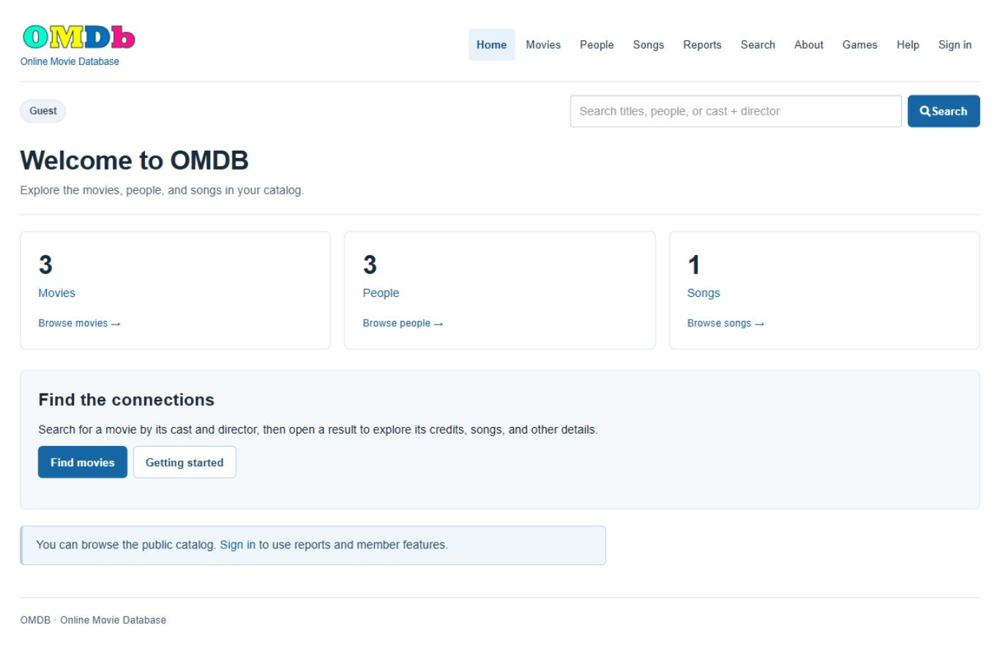
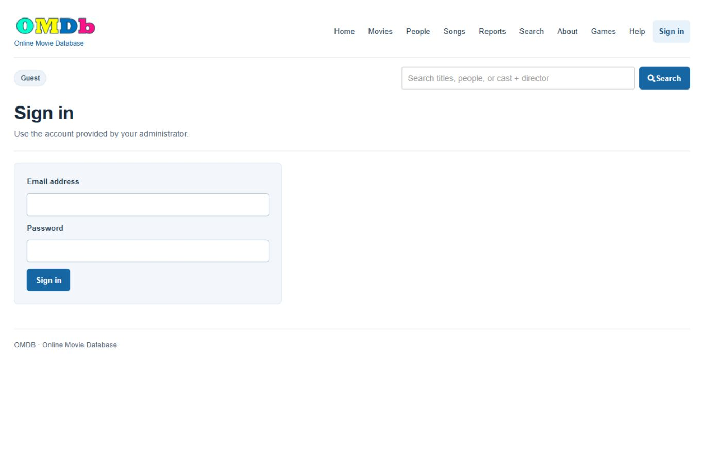
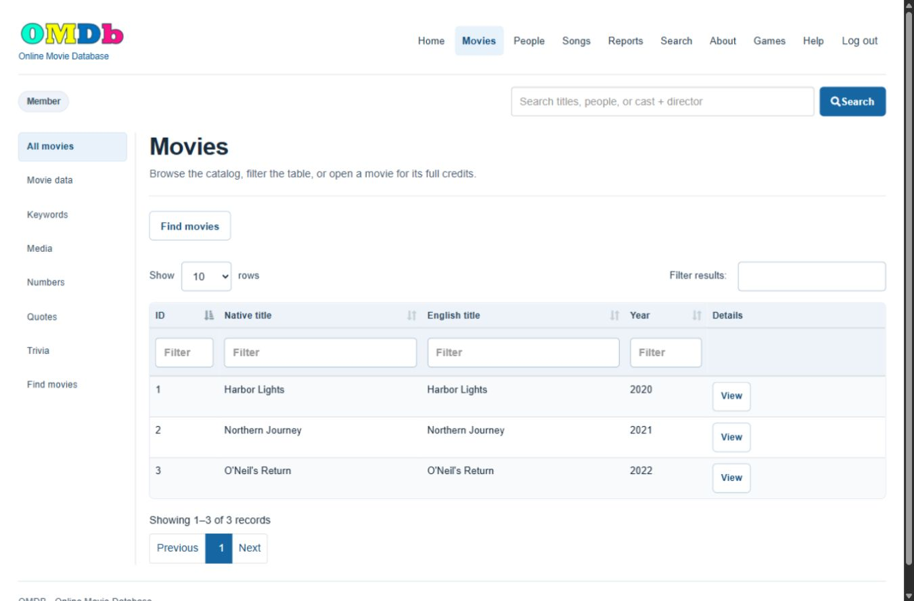
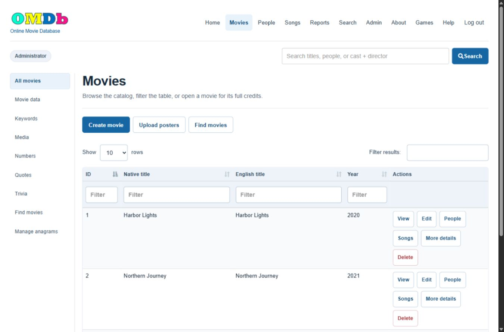
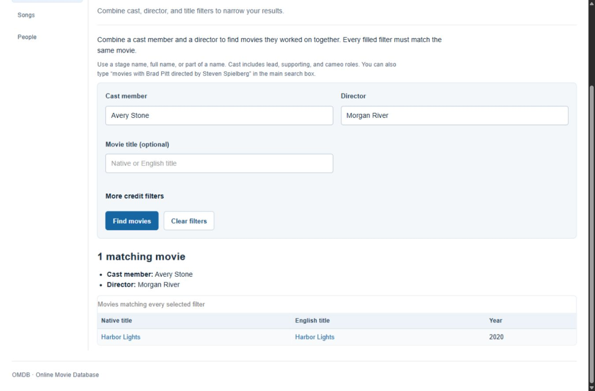
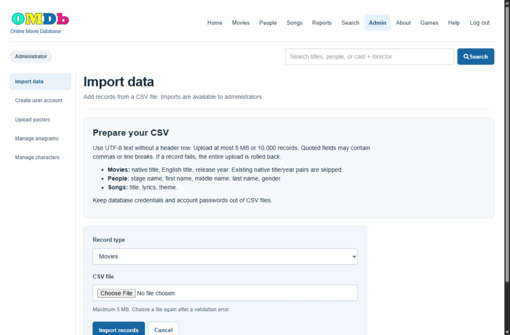
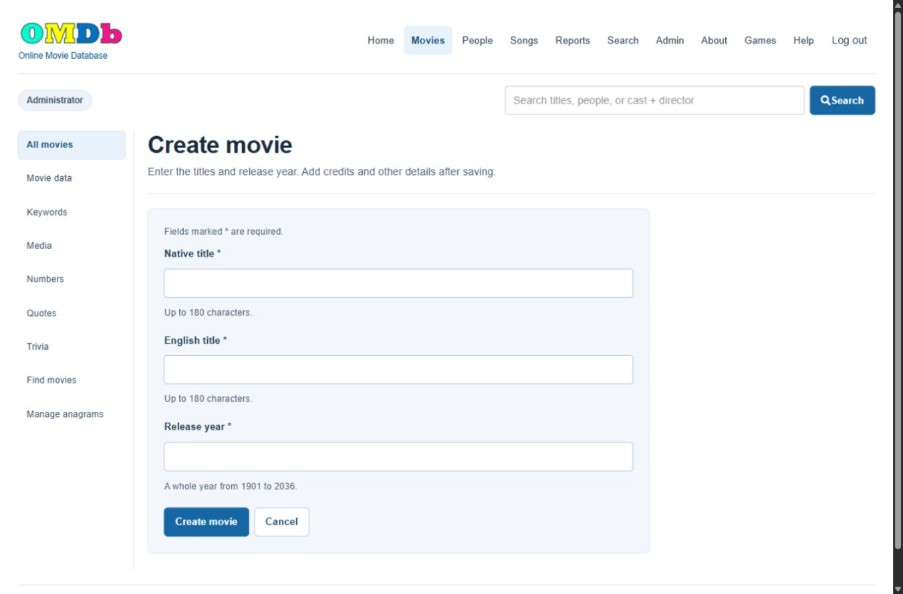
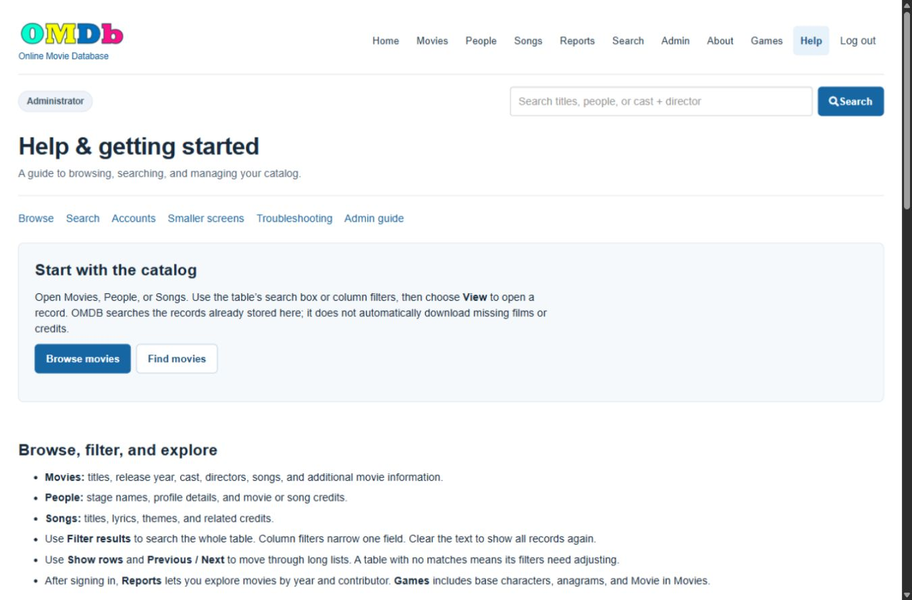
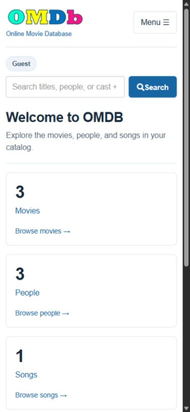

# Screenshots of the final application

Captured from a fresh GitHub installation on November 9, 2026, using the fictional data in [examples](../examples/README.md). No production data, account passwords, or private configuration appears in these images. Desktop captures use 1366 × 900; the phone capture uses 390 × 844. The search screenshot is scrolled to show both the filters and result.

## Home

Catalog counts and the starting links work after importing the three sample CSV files.

## Sign in

Use the account you created during installation. This form intentionally shows no preset credentials.

## Member catalog

Members see View actions and no Admin menu. Search, filters and pagination remain available.

## Administrator catalog

Administrators receive Create, Edit, People, Songs, More details and Delete controls. The endpoints still check the administrator role.

## Combined cast and director search

The fictional cast member Avery Stone and director Morgan River are both credited on Harbor Lights. Every filled filter must match the same movie.

## Administrator imports

Select the record type and a UTF-8 CSV file. The form documents column order and atomic import behavior.

## Create movie

Required fields, length/year limits and Cancel are shown in the form.

## Help

The in-app guide covers browsing, searching, permissions, small screens and admin workflows.

## Phone layout

Navigation collapses behind Menu and catalog cards stack vertically. Wide tables scroll within their own region.

